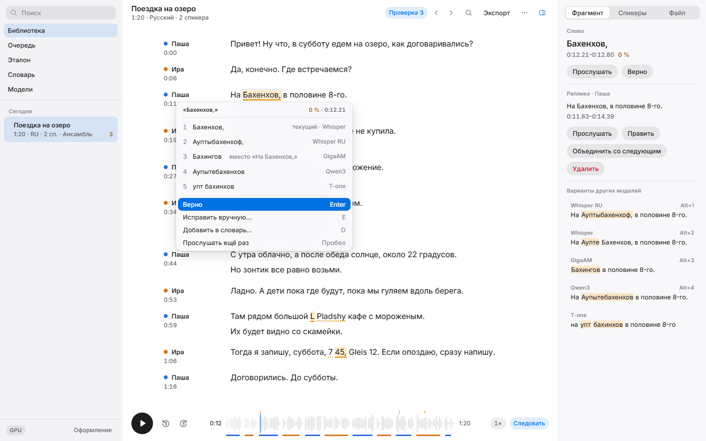
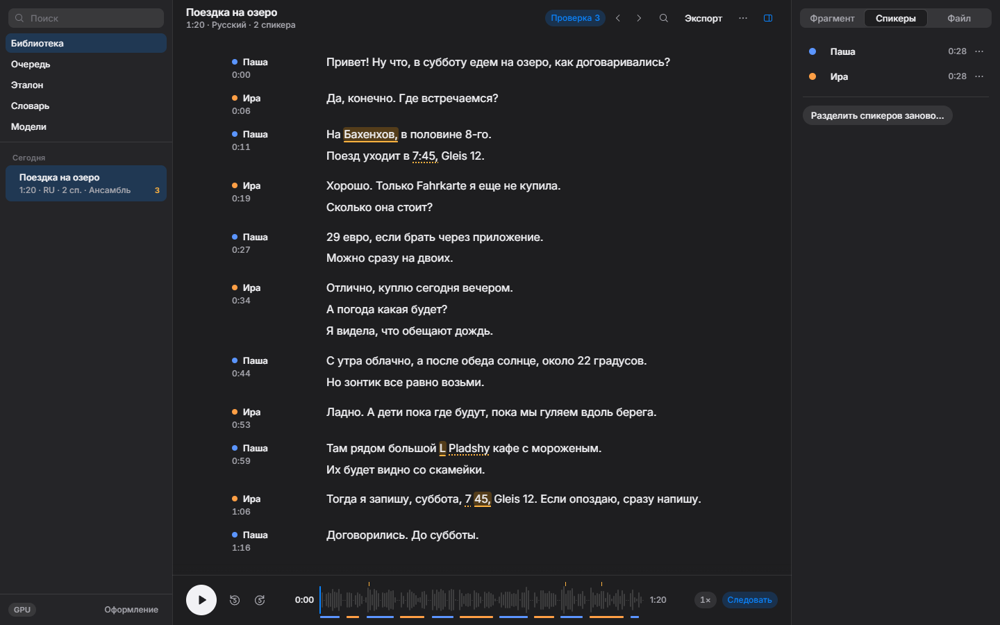
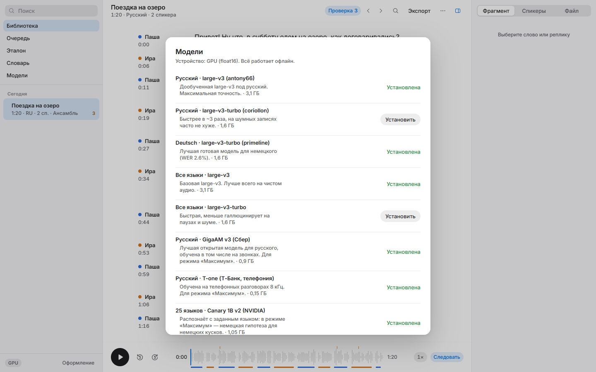
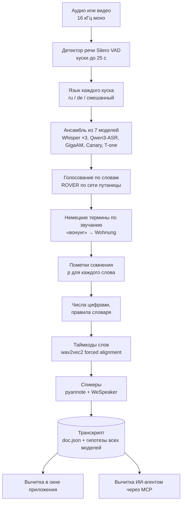
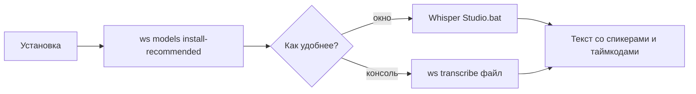
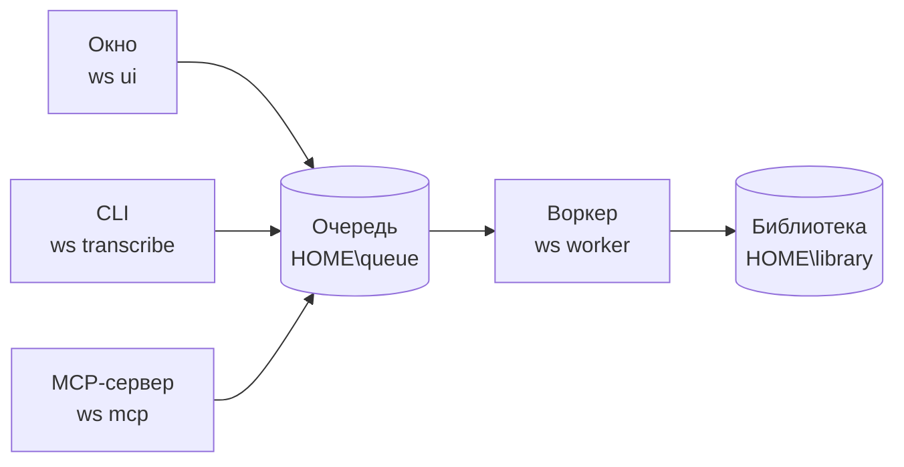

# Whisper Studio

**Точная локальная расшифровка русской речи с немецкими терминами: ансамбль моделей, вычитка и MCP-сервер для ИИ-агентов.**

[](LICENSE)
[](https://www.python.org/)
[](#установка)
[](#установка)
[](MCP-CONNECT.md)

Whisper Studio — десктопное приложение, CLI и MCP-сервер, которые расшифровывают записи прямо на
вашей видеокарте. Звук, тексты и модели не покидают компьютер: сеть нужна один раз, чтобы скачать
модели.

Это одновременно приложение и исследование распознавания русской речи с немецкими словами
(«встретимся у Hauptbahnhof», «какая у вас Hausnummer»). Несколько моделей распознают запись
независимо и голосуют по каждому слову, немецкие слова восстанавливаются по звучанию, а сомнительные
места честно подсвечиваются. ИИ-агенты через MCP могут сами распознавать и вычитывать записи. Каждое
решение проверено опытом на конкретных моделях — Whisper large-v3 и его дообучениях, Qwen3-ASR,
GigaAM v3, Canary 1B v2, T-one — с цифрами в [docs/DECISIONS.md](docs/DECISIONS.md).

> **English summary.** Whisper Studio is a local, offline speech-to-text app for Windows (desktop
> UI, CLI and an MCP server for AI agents), tuned for Russian speech mixed with German terms.
> An ensemble of up to seven ASR models votes word by word (ROVER), German terms are restored by
> sound, and uncertain words are flagged for review. It is also a research log: every design
> choice is backed by experiments on the actual models. Audio never leaves your machine.
> Licensed under GPLv3, Copyright (C) 2026 popkorning.

<p align="center">
  
</p>

<table>
  <tr>
    <td></td>
    <td></td>
  </tr>
</table>

<sub>Демо-запись — синтетический диалог двух голосов Windows TTS. Видно и честные ошибки: немецкое
«Hauptbahnhof» синтезатор произнёс неразборчиво, и приложение подсветило слово, показав варианты
всех моделей.</sub>

## Скачать и установить

Нужны Windows 10/11, видеокарта NVIDIA от 6 ГБ видеопамяти и ~20 ГБ на диске (лучше SSD).

1. Скачайте `Source code (zip)` последнего релиза на странице
   [Releases](https://github.com/popkorning/WhisperStudio/releases/latest) и распакуйте в любую
   папку.
2. Запустите `install.cmd`. Он сам скачает Python 3.12, PyTorch с CUDA и библиотеки — всё внутрь
   этой папки, система не меняется — и предложит скачать базовые модели (~13 ГБ).
3. Запускайте `Whisper Studio.bat`.

Удалить программу — удалить папку (записи и модели лежат в `%LOCALAPPDATA%\WhisperStudio`).
Ручная установка и подробности — в разделе [Установка](#установка).

## Содержание

- [Скачать и установить](#скачать-и-установить)
- [Возможности](#возможности)
- [Как это работает](#как-это-работает)
- [Почему так — в цифрах](#почему-так--в-цифрах)
- [Установка](#установка)
- [Быстрый старт](#быстрый-старт)
- [Использование](#использование)
- [Модели и лицензии](#модели-и-лицензии)
- [Разработка](#разработка)
- [Лицензия](#лицензия)
- [Благодарности](#благодарности)

## Возможности

| | |
|---|---|
| **Ансамбль из 7 моделей** | Whisper large-v3 (обычный и дообученный под русский), Whisper large-v3-turbo под немецкий, Qwen3-ASR 1.7B, GigaAM v3, Canary 1B v2, T-one. Голосование по словам (ROVER по сети путаницы): на эталоне 5,3% WER против 19–38% у отдельных моделей ([DECISIONS](docs/DECISIONS.md)). |
| **Смешанная речь** | Язык определяется для каждого куска до 25 с: на русских кусках голосуют русские модели, на немецких — немецкие, на смешанных — обе группы. Ничего не переводится. |
| **Немецкие термины** | Слово, записанное кириллицей «по звуку», сопоставляется со словарём проекта и выученным списком терминов, с русскими окончаниями («Wohnungу»). |
| **Пометки сомнения** | Подсвечено около 7% слов, и в них около 82% всех ошибок. F3 / Shift+F3 — переход по сомнительным словам, во всплывающем окне — что услышали другие модели. |
| **Числа цифрами** | «25000 евро», «3 марта», «в 7:30», «19%»; сказанные слова хранятся отдельно. |
| **Таймкоды слов** | wav2vec2 CTC forced alignment; клик по слову проигрывает его. |
| **Спикеры** | pyannote segmentation 3.0 + WeSpeaker ResNet293 на GPU; в стерео-звонке канал = спикер. Переразметка с другим числом спикеров — мгновенно. |
| **Быстрый режим** | Одна модель Whisper под язык (faster-whisper) с мягким VAD против галлюцинаций. |
| **Редактор для вычитки** | Правка с сохранением таймкодов, переназначение спикеров, поиск и замена по всем записям, история и отмена, экспорт txt / md / srt / vtt / json. |
| **Словарь проекта** | Термины, правила замены «как распознано → как правильно», контекст записи. |
| **Вычитка языковой моделью** | Любой OpenAI-совместимый сервер (LM Studio, Ollama, llama.cpp) или подключённый ИИ-агент; модель выбирает только из того, что услышали распознаватели. |
| **Эталон** | Записи, выверенные на слух, и оценка моделей и ансамбля по ним прямо в приложении ([GOLD](docs/GOLD.md)). |
| **MCP-сервер** | Для Claude Code, Codex и других клиентов: распознать, найти, вычитать, исправить ([MCP-CONNECT](MCP-CONNECT.md)). |

## Как это работает

### Звук: от записи до вычитанного текста



Все модели слушают одни и те же куски, независимо друг от друга и без переноса контекста: один
плохой кусок не тянет за собой следующие. На видеокарте модели работают строго по одной, их сырые
гипотезы сохраняются после каждой — прерванная задача продолжается с недостающей модели, а слияние
можно пересчитать без GPU.

Голосование выбирает слово, за которое больше взвешенных голосов; «здесь ничего не сказано» — тоже
голос. Но немецкий термин внутри русской фразы все модели пишут кириллицей, поэтому после слияния
отдельный шаг ищет такие слова по звучанию в словаре проекта и выученном списке терминов, сверяясь
с тем, что слышали другие модели. Русское окончание сохраняется: «Wohnungу».

Каждое слово получает оценку уверенности p. Сомнительные подсвечиваются, а во всплывающем окне видно,
что услышали остальные модели. Вычитывать можно вручную или поручить агенту через MCP: агент
выбирает из вариантов моделей, а не сочиняет текст заново.

## Почему так — в цифрах

Все цифры — из [docs/DECISIONS.md](docs/DECISIONS.md). Эталон — запись, выверенная на слух; синтетика — выдуманные диалоги, озвученные клонированными
голосами и пропущенные через телефонный кодек.

| Что пробовали | Результат | Решение |
|---|---|---|
| Ансамбль вместо одной модели | WER на эталоне: лучшие одиночные модели 19,3–19,7%, слияние семи — **7,0%** | ✅ по умолчанию |
| Поиск немецких терминов по звучанию после слияния | ошибок 45 → **34** (WER 7,0% → **5,3%**), латиница неверно 20 → 11 из 23 | ✅ принято |
| Ещё больше моделей: 21 вместо 7 | 93 ошибки слияния против 34; ни одна из 21 не написала латиницей ни одного из 23 немецких слов | ❌ отвергнуто |
| Подсказать термины Whisper при распознавании | ошибок 34 → 58–62: модели подгоняют русскую речь под список | ❌ отвергнуто |
| Смешанный режим (язык каждого куска) | синтетика с немецкой сценой: WER 15,4% → **4,8%**; немецкая речь: 94,4% → 3,3% ошибок | ✅ по умолчанию |
| Пометки сомнения из признаков голосования | подсвечено ~7% слов, в них **82%** ошибок | ✅ принято |
| Вычитка маленькой локальной LLM (1,7–4B) | ошибок 34 → 36–46: «чинит» грамматику, а не ослышки | ❌ вычитка — за сильной моделью |
| Спикеры: эмбеддинги на GPU и доработка разметки | в 4,1–5,3 раза быстрее sherpa-onnx на CPU; WDER на эталоне 2,97% → **1,55%** | ✅ принято |

На эталоне такого объёма разница меньше ~1,5 п. п. (около 10 ошибок) — шум, поэтому настройки
принимаются, только если они не хуже сразу на эталоне, на синтетике и в библиотеке реальных записей.
Как устроены процессы, модули и форматы данных — [docs/ARCHITECTURE.md](docs/ARCHITECTURE.md).

## Установка

### Что нужно

| | Минимум | Примечание |
|---|---|---|
| **ОС** | Windows 10 / 11 | окно — WebView2 через pywebview; код использует `winreg`, `msvcrt`, `pywin32`. На других ОС не проверялось |
| **Видеокарта** | NVIDIA с CUDA, от 6 ГБ видеопамяти | проверено на RTX 2060 6 ГБ; модели работают на GPU по одной. Без GPU не тестировалось |
| **Python** | 3.12 | |
| **ОЗУ** | от 16 ГБ | |
| **Диск** | ~18 ГБ под модели | venv и модели — на SSD (см. ниже) |

> [!TIP]
> Держите venv и папку моделей на SSD. С HDD каждая запись тратит минуты на чтение моделей и
> импорт torch: на HDD ~3,5 мин чтения на запись и ~45 с импорта на каждый новый процесс воркера,
> на SSD импорт — 6,9 с ([DECISIONS](docs/DECISIONS.md#11-скорость)).

### Шаги

Это ручной путь; `install.cmd` делает шаги 1–3 и 5 сам.

**1. Код и окружение.** Виртуальное окружение — в папке `.venv` в корне репозитория: его сами
находят обёртки `ws.cmd` и `Whisper Studio.bat`.

```bat
git clone https://github.com/popkorning/WhisperStudio.git
cd WhisperStudio
py -3.12 -m venv .venv
.venv\Scripts\activate
python -m pip install --upgrade pip
```

**2. PyTorch с CUDA.** Ставится первым, из своего индекса. Проверено с CUDA 12.8:

```bat
pip install torch==2.11.0 torchvision==0.26.0 --index-url https://download.pytorch.org/whl/cu128
```

Под другую версию CUDA колесо подберите на [pytorch.org](https://pytorch.org/get-started/locally/).

**3. Остальные зависимости.** Версии, с которыми приложение проверено, закреплены в
`requirements.txt`:

```bat
pip install -r requirements.txt
```

`onnxruntime-gpu` не нужен: эмбеддинги спикеров считаются на GPU через torch.

**4. Папка данных (необязательно).** Модели, записи и настройки лежат вне кода, в
`WHISPER_STUDIO_HOME`. По умолчанию это `%LOCALAPPDATA%\WhisperStudio`. Чтобы держать их в другом
месте (например, на SSD), задайте переменную и откройте новое окно консоли:

```bat
setx WHISPER_STUDIO_HOME "<папка данных>"
```

Там же можно положить необязательный `voices\owner.npz` — профиль вашего голоса, чтобы приложение
подписывало ваши реплики. Собирается из записи с выверенной разметкой спикеров:
`python tools\diarize_eval.py make-ref <id> --out ref.json`, затем
`python tools\diarize_eval.py owner <id> --ref ref.json` (подробности — в начале скрипта).

**5. Модели.** В репозитории их нет: они скачиваются по требованию с Hugging Face (модели спикеров —
с релизов sherpa-onnx на GitHub) в `WHISPER_STUDIO_HOME\models\<ключ>`, и у каждой своя лицензия
(см. [Модели и лицензии](#модели-и-лицензии)). Скачать можно из окна (лист «Модели») или из консоли:

```bat
:: что есть и что уже установлено
ws models list

:: база: Whisper large-v3, turbo, ru, de + выравнивание ru/de/en + спикеры
ws models install-recommended

:: остальные участники ансамбля «Максимум»
ws models install gigaam-v3 t-one canary-v2 qwen3-asr
```

Fine-tune Whisper в формате transformers при установке сами конвертируются в CTranslate2 float16.

**6. Проверка (по желанию).** Тесты создают себе временную папку данных и реальные модели не трогают:

```bat
python -m unittest discover -s tests
```

Чтобы прогнать и тесты на настоящих моделях, укажите `WS_REAL_HOME` — папку данных с установленными
моделями.

## Быстрый старт



`ws` — это `ws.cmd` в корне репозитория (то же, что `python -m whisper_studio` из `.venv`). Команды
ниже запускаются из корня репозитория; в PowerShell пишите `.\ws`.

**В окне.** Двойной клик по `Whisper Studio.bat` (или `ws ui`), затем откройте запись. `ws shortcut`
создаёт ярлык «Транскрибация» на рабочем столе.

**В консоли.** Результат ляжет рядом с файлом:

```bat
ws transcribe "запись.ogg" --format txt,srt
```

Без параметров берутся умолчания из `settings.json`: русский язык, смешанный режим, 2 спикера,
качество «Максимум». Чаще всего меняют:

```bat
ws transcribe звонок.wav --stereo                      :: стерео-звонок: канал = спикер
ws transcribe запись.m4a --speakers 3 --glossary "Hauptbahnhof, Straßenbahn"
ws transcribe запись.m4a --no-mixed --lang de          :: один язык на весь файл
ws transcribe запись.ogg --print                       :: текст сразу в консоль
```

Первая запись идёт дольше остальных: воркер загружает модели. Ориентир на RTX 2060 в режиме
«Максимум» — 11 минут звука ≈ 13 минут.

### Если что-то не так

| Симптом | Что делать |
|---|---|
| `ws` не находится | запускайте из корня репозитория; в PowerShell — `.\ws`. Либо `python -m whisper_studio …` с корнем репозитория в `PYTHONPATH` |
| Окно не открывается | нужен WebView2 (компонент Windows). Повторный запуск выводит уже открытое окно на передний план — проверьте панель задач |
| Каждая запись начинается с долгой паузы | venv или модели на HDD — перенесите на SSD. Воркер выходит через 120 с простоя и потом грузит модели заново (`WHISPER_STUDIO_WORKER_IDLE`) |
| «Максимум» точнее не стал | установлены не все семь моделей: режим работает с теми, что есть. Проверьте `ws models list` |
| Не хватает видеопамяти | закройте другие программы на GPU. Перед загрузкой модели приложение ждёт свободную память, а если она кончилась посреди записи — перезагружает модель и повторяет кусок |
| Задача висит или упала | журнал воркера — `WHISPER_STUDIO_HOME\queue\worker.log`; очередь переживает перезапуск |

## Использование

Везде ниже `ws` означает `python -m whisper_studio` из venv, с корнем репозитория в `PYTHONPATH`.
`ws.cmd` и `Whisper Studio.bat` в корне репозитория уже делают это сами: берут python из `.venv`
в корне, а если его нет, то из `PATH`.

У приложения три входа: окно, командная строка и MCP-сервер. Работают они с одной и той же
библиотекой записей и одной очередью задач.



### Приложение

```bat
ws ui
```

Или двойной клик по `Whisper Studio.bat`. Команда `ws shortcut` создаёт на рабочем столе ярлык
«Транскрибация». Если окно уже открыто, повторный запуск просто выводит его на передний план.

Окно спокойное и сделано для вычитки. Слева сайдбар: поиск, библиотека, очередь, эталон, словарь,
модели. В центре текст, разбитый на реплики по спикерам. Справа инспектор: фрагмент и варианты
моделей, спикеры, сведения о файле. Внизу плеер с волной и полосой спикеров.

Что можно сделать в окне:

- **Распознать** аудио или видео. Задача встаёт в общую очередь.
- **Слушать текст.** Клик по слову проигрывает это слово, Ctrl+клик или клик по времени играет запись
  с этого места.
- **Править.** Двойной клик по фрагменту открывает правку: Enter сохраняет, Tab переходит к
  следующему фрагменту, Esc отменяет. Таймкоды при правке сохраняются.
- **Разбираться со спикерами.** Правый клик по слову делит фрагмент или назначает другого спикера с
  этого слова. Клик по имени спикера позволяет переименовать его, переназначить реплику или объединить
  двух спикеров.
- **Проверять сомнительные места.** Подсвеченное слово значит, что модели не уверены (p < 0,35),
  пунктир означает слабое сомнение (p < 0,5). F3 и Shift+F3 переходят по таким словам, а
  всплывающее окно показывает, что услышали другие модели.
- **Искать и заменять.** Ctrl+Shift+F ищет по названиям и тексту всех записей, Ctrl+F находит и
  заменяет, Ctrl+Z отменяет правку.
- **Вести словарь проекта**: термины, правила замены «как распознано → как правильно», контекст.
- **Вычитать языковой моделью** через любой OpenAI-совместимый сервер (LM Studio, Ollama,
  llama.cpp).
- **Скачивать модели** на листе «Модели».
- **Работать с эталоном** (Ctrl+3): выверять записи на слух и оценивать по ним модели и ансамбль.
  Подробнее в [docs/GOLD.md](docs/GOLD.md).
- **Экспортировать** в txt, md, srt, vtt или json.

Есть светлая и тёмная тема и масштаб от 100 до 200%.

### Командная строка

| Команда | Что делает |
|---|---|
| `ws transcribe <файлы…>` | распознать аудио или видео |
| `ws list` | показать библиотеку транскриптов |
| `ws show <id>` | показать транскрипт (`--format txt`, `md`…) |
| `ws search "<текст>"` | искать по всем транскриптам |
| `ws export <id> --format srt --out <файл>` | экспортировать транскрипт |
| `ws models list` / `install <ключи…>` / `install-recommended` | показать и скачать модели |
| `ws redoubt [<id>…]` | пересчитать пометки сомнения по сохранённым гипотезам, без GPU |
| `ws renumber [<id>…] [--dry-run]` | записать числа цифрами в готовых транскриптах, без GPU |
| `ws gold-eval [--tune]` | оценить ансамбль по эталонам |
| `ws ui` / `ws shortcut` | открыть приложение / создать ярлык на рабочем столе |
| `ws mcp` | запустить MCP-сервер (stdio) |
| `ws worker` | запустить фоновый воркер очереди (обычно он стартует сам) |

Основные параметры `ws transcribe`:

| Параметр | Что задаёт |
|---|---|
| `--lang` | язык: `ru`, `de`, `en`… или `auto` |
| `--mixed` / `--no-mixed` | русская речь с немецкими словами или один язык на весь файл |
| `--speakers N` | число спикеров |
| `--glossary "…"` | имена и термины этой записи через запятую |
| `--topic "…"` | о чём запись, одним предложением |
| `--model`, `--profile` | ключ модели из `ws models list`; профиль `balanced`, `clean` или `noisy` |
| `--stereo` | стерео-звонок: каждый канал считается отдельным спикером |
| `--highpass` | фильтр гула 80 Гц |
| `--no-diarize`, `--no-align` | без разметки спикеров, без пословных таймкодов |
| `--format txt,md,srt,vtt,json` | форматы результата |
| `--out <папка>`, `--print` | куда положить результат; вывести текст в stdout |
| `--here` | считать в этом процессе, а не в общем воркере |

Параметры, которые вы не задали, берутся из `settings.json`. По умолчанию там стоят язык ru,
смешанный режим, 2 спикера и качество «max».

Примеры:

```bat
ws transcribe "запись.ogg" --speakers 2 --glossary "Hauptbahnhof, Straßenbahn" --format txt,srt
ws transcribe звонок.wav --stereo --profile noisy
ws transcribe лекция.mp3 --no-mixed --lang de --print
```

### MCP-сервер

`ws mcp` запускает локальный MCP-сервер (stdio). Он даёт ИИ-агенту (Claude Code, Codex, Claude
Desktop и другим клиентам) те же записи, что видит пользователь в окне, вместе с его правками.
Сеть и токены для этого не нужны. Сервер лёгкий и сам модели не загружает: задачи встают в общую
очередь, а считает их воркер.

| Группа | Инструменты |
|---|---|
| Распознавание | `transcribe_audio`, `start_transcription`, `get_status` |
| Поиск и чтение | `list_transcripts`, `find_transcripts`, `search_transcripts`, `get_transcript`, `export_transcript` |
| Вычитка и правка | `proofread_pack`, `apply_corrections`, `edit_segment`, `replace_text`, `undo` |
| Спикеры | `rediarize`, `rename_speaker`, `set_segment_speaker` |
| Словарь | `get_dictionary`, `update_dictionary` |
| Модели | `list_models` |

Минимальный блок для `mcpServers` в JSON-конфиге клиента. Обратные слэши в JSON удваиваются:

```json
"whisper-studio": {
  "type": "stdio",
  "command": "<путь к venv>\\Scripts\\python.exe",
  "args": ["-m", "whisper_studio", "mcp"],
  "env": {
    "PYTHONPATH": "<путь к репозиторию>",
    "PYTHONIOENCODING": "utf-8",
    "WHISPER_STUDIO_HOME": "<папка данных>"
  }
}
```

`WHISPER_STUDIO_HOME` должна совпадать с папкой данных приложения, иначе агент увидит другую
библиотеку. Команды для Claude Code и Codex и порядок работы агента описаны в
[MCP-CONNECT.md](MCP-CONNECT.md).

### Фоновый воркер и очередь

Окно, MCP и `ws transcribe` сами ничего не считают. Они кладут задачу файлом
`job-*.json` в `HOME\queue\` и при необходимости поднимают воркер (`ws worker`). Воркер на машине
один (`worker.lock`). Он берёт задачи по порядку, держит модели загруженными между задачами и
выходит через 120 с простоя, освобождая RAM и видеопамять (`WHISPER_STUDIO_WORKER_IDLE`). Файл
задачи удаляется только после её конца, поэтому очередь переживает перезапуск. Так все входы
делят одну видеокарту, а окно и MCP стартуют за доли секунды. Флаг `--here` у CLI считает задачу
в своём процессе, без воркера. Тогда не запускайте рядом другую задачу на той же видеокарте.

### Папка данных

Модели, библиотека записей и настройки лежат вне кода, в папке `WHISPER_STUDIO_HOME`. По умолчанию
это `%LOCALAPPDATA%\WhisperStudio`. `WHISPER_STUDIO_MODELS` переопределяет только папку моделей.

```text
WHISPER_STUDIO_HOME\
├── models\               модели, по папке на ключ из `ws models list`
├── hf-cache\             кэш Hugging Face (сюда указывает HF_HOME)
├── library\
│   └── <id>\             одна запись: doc.json, аудио, peaks.json, hypotheses.json
│                         (гипотезы всех моделей), voices.npz (голоса спикеров), история правок
├── queue\                задачи воркера (job-*.json), worker.lock, worker.log
├── gold\                 итоги оценки по эталону (latest.json, history.jsonl)
├── settings.json         умолчания распознавания, адрес LLM, ускорения (speed)
├── dictionary.json       словарь проекта: термины, замены, контекст
├── tmp\                  временные файлы
│
│   необязательно:
├── terms-learned.json    выученный список немецких терминов
└── voices\
    └── owner.npz         профиль вашего голоса
```

Необязательные файлы:

| Файл | Зачем | Как получить |
|---|---|---|
| `dictionary.json` | термины, правила замены и контекст проекта для распознавания и вычитки | создаётся из окна (лист «Словарь») или через MCP `update_dictionary` |
| `terms-learned.json` | немецкие существительные из ваших текстов для восстановления терминов по звучанию. Без него работает только словарь проекта | `python tools\build_terms.py --wiki <папка с .md>` (или `--no-wiki`) |
| `voices\owner.npz` | ваш голос: спикер, который на него похож, получает ваше имя («Я», если имя в профиле не задано) | `python tools\diarize_eval.py owner <id> --ref ref.json` по записи с выверенными спикерами |

## Модели и лицензии

> [!NOTE]
> Модели **не входят в репозиторий**. Приложение скачивает их по требованию с Hugging Face (модели
> спикеров — с релизов sherpa-onnx на GitHub) в `WHISPER_STUDIO_HOME\models\<ключ>`. На каждую модель
> действует её собственная лицензия, а не лицензия кода. Перед коммерческим использованием
> сверьтесь с карточкой модели.

«Не указана» значит, что в карточке модели лицензии нет: все права остаются за автором, и для
чего-либо сверх личного использования нужно спросить автора.

### Распознавание речи

| Ключ | Модель (репозиторий) | Лицензия |
|---|---|---|
| `large-v3` | OpenAI Whisper large-v3, CTranslate2 (`Systran/faster-whisper-large-v3`) | MIT |
| `large-v3-turbo` | OpenAI Whisper large-v3-turbo, CTranslate2 (`deepdml/faster-whisper-large-v3-turbo-ct2`) | MIT |
| `ru-large-v3` | `antony66/whisper-large-v3-russian` | не указана (база `openai/whisper-large-v3`, Apache-2.0) |
| `ru-turbo` | `coriollon/whisper-large-v3-turbo-russian` (не в ансамбле) | Apache-2.0 |
| `de-turbo` | `primeline/whisper-large-v3-turbo-german` | Apache-2.0 |
| `qwen3-asr` | `Qwen/Qwen3-ASR-1.7B-hf` | Apache-2.0 |
| `gigaam-v3` | GigaAM v3 (Сбер), ONNX `istupakov/gigaam-v3-onnx` | MIT |
| `t-one` | `t-tech/T-one` | Apache-2.0 |
| `canary-v2` | NVIDIA Canary 1B v2, ONNX `istupakov/canary-1b-v2-onnx` | CC-BY-4.0 |
| — | Silero VAD (внутри faster-whisper) | MIT |

### Таймкоды слов и спикеры

| Ключ | Модель (репозиторий) | Лицензия |
|---|---|---|
| `align-ru`, `align-de`, `align-en` | `jonatasgrosman/wav2vec2-large-xlsr-53-{russian,german,english}` | Apache-2.0 |
| `diarization` | pyannote segmentation 3.0 (сборка sherpa-onnx) | MIT |
| `diarization` | WeSpeaker ResNet293 VoxCeleb (`wespeaker_en_voxceleb_resnet293_LM`, сборка sherpa-onnx) | CC-BY-4.0 |

### Данные

| Что | Откуда | Лицензия |
|---|---|---|
| Словари pymorphy3 | pip-пакет `pymorphy3-dicts-ru` | пакет — MIT, данные OpenCorpora — CC BY-SA 3.0 |

Модели, которые пробовались только в опытах (`tools/`) и в приложение не вошли (Qwen3 / Qwen3.5,
LFM, RuModernBERT, multilingual-e5-small, RUPunct, Parakeet, Vosk и др.), приложение не скачивает.

## Разработка

### Тесты

```bat
python -m unittest discover -s tests
```

Тесты создают себе временную папку `WHISPER_STUDIO_HOME` и не трогают настоящую. Тесты, которым
нужны настоящие модели, берут их из папки, на которую указывает `WS_REAL_HOME`:

```bat
set WS_REAL_HOME=<папка данных>
python -m unittest discover -s tests
```

### Где что лежит

| Путь | Что там |
|---|---|
| `whisper_studio/` | приложение: конвейер, ансамбль, слияние, окно, CLI, MCP |
| `tests/` | модульные тесты |
| `tools/` | лабораторные инструменты: оценка моделей и ансамбля, опыты с терминами, спикерами, синтетические диалоги, сборка `terms-learned.json` |
| `docs/ARCHITECTURE.md` | устройство: процессы, конвейер, модули, форматы данных |
| `docs/DECISIONS.md` | технические решения и отвергнутые идеи — с цифрами |
| `docs/IDEAS.md` | идеи на потом и что из них уже проверено |

Новую идею сначала проверяют инструментом из `tools/` на эталоне и только потом переносят в
приложение. Итог опыта — принято или отвергнуто и почему — записывается в
[docs/DECISIONS.md](docs/DECISIONS.md).

Комментарии в коде — на английском, документация — на русском.

### Участие

Issues и pull request'ы приветствуются: ошибки, неудачные записи (без личных данных), новые
модели для ансамбля, поддержка других ОС. Если меняется точность, приложите замер по эталону
(`ws gold-eval`) до и после.

## Лицензия


```text
Copyright (C) 2026 popkorning
```

Код распространяется под **GNU General Public License v3.0**. Полный текст — в файле
[`LICENSE`](LICENSE) и на <https://www.gnu.org/licenses/gpl-3.0.html>.

Простыми словами:

- код можно **использовать, изучать, менять и распространять**, в том числе за деньги;
- если вы распространяете программу или её изменённую версию, вы обязаны **открыть исходный код**
  под той же GPLv3 и сохранить уведомления об авторских правах;
- гарантий нет: программа поставляется «как есть».

Лицензия кода **не распространяется на модели**: они скачиваются отдельно и подчиняются своим
лицензиям (см. [Модели и лицензии](#модели-и-лицензии)). Сторонние Python-библиотеки ставятся из
pip и идут под своими лицензиями.

**Файлы сторонних проектов в репозитории** (обе лицензии совместимы с GPLv3):

| Что | Где | Лицензия |
|---|---|---|
| wavesurfer.js с плагинами hover, regions, timeline | `whisper_studio/web/vendor/` | BSD-3-Clause, `whisper_studio/web/vendor/wavesurfer.LICENSE` |
| Шрифт Inter | `whisper_studio/web/vendor/fonts/` | SIL OFL 1.1, `whisper_studio/web/vendor/fonts/Inter.LICENSE` |

## Благодарности

Whisper Studio стоит на плечах открытых проектов и моделей. Спасибо их авторам.

**Распознавание речи**

- [OpenAI Whisper](https://github.com/openai/whisper) — модели large-v3 и large-v3-turbo.
- [faster-whisper](https://github.com/SYSTRAN/faster-whisper) и
  [CTranslate2](https://github.com/OpenNMT/CTranslate2) — быстрый Whisper на GPU.
- Авторы дообученных Whisper: antony66 (русский), coriollon (русский turbo), primeline (немецкий).
- [Qwen3-ASR](https://huggingface.co/Qwen/Qwen3-ASR-1.7B-hf) (Qwen, Alibaba).
- [GigaAM](https://github.com/salute-developers/GigaAM) (Сбер).
- [T-one](https://huggingface.co/t-tech/T-one) (Т-Банк).
- [NVIDIA Canary](https://huggingface.co/nvidia/canary-1b-v2).
- [onnx-asr](https://github.com/istupakov/onnx-asr) — запуск GigaAM, T-one и Canary в ONNX.
- [Silero VAD](https://github.com/snakers4/silero-vad) — детектор речи.

**Таймкоды и спикеры**

- wav2vec2 XLSR-53 в дообучении jonatasgrosman и рецепт выравнивания
  [WhisperX](https://github.com/m-bain/whisperX).
- [pyannote](https://github.com/pyannote/pyannote-audio) segmentation 3.0 и
  [WeSpeaker](https://github.com/wenet-e2e/wespeaker).
- [sherpa-onnx](https://github.com/k2-fsa/sherpa-onnx) — сборки моделей спикеров и разметка на CPU.

**Остальное**

- [Hugging Face Transformers](https://github.com/huggingface/transformers) и
  [PyTorch](https://pytorch.org/).
- [pymorphy3](https://github.com/no-plagiarism/pymorphy3) и словари
  [OpenCorpora](https://opencorpora.org/).
- [RapidFuzz](https://github.com/rapidfuzz/RapidFuzz), [PyAV](https://github.com/PyAV-Org/PyAV).
- [wavesurfer.js](https://wavesurfer.xyz/) — волна звука в редакторе.
- [Inter](https://rsms.me/inter/) — шрифт интерфейса.
- [pywebview](https://pywebview.flowrl.com/) — окно приложения.
